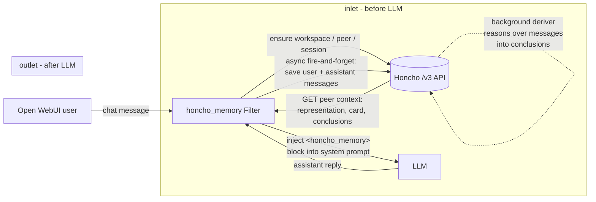

# Honcho Memory for Open WebUI

**Persistent, reasoning-based memory for Open WebUI, powered by [Honcho](https://honcho.dev).**

[Honcho](https://honcho.dev) is open-source memory that *reasons*: instead of only
embedding and retrieving text, it maintains **peers** (users & assistants),
**sessions**, **messages**, and derived **conclusions** — plus **peer cards**
(summarized identity), **dreaming** (background reasoning over accumulated
history), and **dialectic chat** (ask questions *about* a user and get reasoned
answers). This project packages that as a single-file **Open WebUI Filter**:
`dist/honcho_memory.py`.

Open WebUI ships a built-in memory (per-user notes + a `search_memory` tool). It's
great for simple recall, but it's flat: no background reasoning over your chat
history, no derived conclusions, no peer cards, no cross-session "what do I know
about this person" answers. Honcho Memory augments — not replaces — it:

- **Every turn**: the model gets a short `<honcho_memory>` block of facts about
  *you* (peer representation, peer card, recent conclusions) in its system prompt.
- **Every message**: saved to a Honcho session, where Honcho's **deriver** reasons
  over it asynchronously and distills durable conclusions.
- The more you chat, the better it knows you — and it says so only when relevant.

## Architecture



- **inlet** (before the model): fetch the current user's peer context from Honcho
  and inject it into the system prompt inside a `<honcho_memory>` block.
- **outlet** (after the model): fire-and-forget save of the latest user + assistant
  messages to the session; Honcho's deriver reasons over them **asynchronously**, so
  your chat is never delayed.

## Install

1. Build the single file: `python build.py` (or grab it from a release) → `dist/honcho_memory.py`.
2. In Open WebUI: **Admin Panel → Functions → New Function**, paste the contents of
   `dist/honcho_memory.py`, save.
3. Enable it **globally** (Admin → Functions → toggle on) or per-model
   (**Workspace → Models → edit model → Filters**).
4. Open the function's **Valves** (admin) and set:
   - `honcho_url` — base URL of your Honcho server (default `http://localhost:8000`).
   - `api_key` — your Honcho API key (JWT).

Users can additionally set **UserValves** per-account (enabled / share_memory /
show_status / reasoning_level / extra_instructions).

## Valves (admin)

| Valve | Default | Description |
|---|---|---|
| `honcho_url` | `http://localhost:8000` | Honcho server base URL (`/v3` base path). |
| `api_key` | *(empty)* | Honcho API key. Sent only as `Authorization: Bearer`. |
| `workspace_id` | `open-webui` | Honcho workspace id (one workspace per install). |
| `peer_prefix` | `user-` | Prefix for user peer ids: `{prefix}{owui_user_id}`. |
| `per_model_assistant_peer` | `true` | One assistant peer per model id (`assistant-{model}`), else fixed `assistant`. |
| `inject_position` | `system` | Where to inject the memory block: `system` or `user`. |
| `enable_injection` | `true` | Inject memory into the prompt at all. |
| `enable_saving` | `true` | Save messages to Honcho at all. |
| `inject_peer_card` | `true` | Include the peer card in the block. |
| `inject_representation` | `true` | Include the reasoned representation in the block. |
| `context_max_chars` | `3000` | Max characters of the injected memory block. |
| `search_top_k` / `max_conclusions` | `10` / `25` | Honcho context-retrieval knobs. |
| `save_assistant_messages` | `true` | Save assistant replies too (so Honcho can reason about the conversation). |
| `save_max_chars` | `2000` | Per-message truncation before saving. |
| `timeout_seconds` | `10` | HTTP timeout for Honcho calls. |
| `show_status` | `true` | Show "Recalling memories…" / "Recalled N facts" status in the UI. |
| `debug` | `false` | Verbose logging (never logs secrets). |
| `priority` | `0` | Filter priority ordering. |
| `mirror_owui_memories` | `true` | Reserved for two-way sync with OWUI built-in memory (see ROADMAP); currently a no-op hook. |

### UserValves (per user)

| Valve | Default | Description |
|---|---|---|
| `enabled` | `true` | Master per-user opt-out: off = no fetch, no save. |
| `share_memory` | `true` | Off = still inject, but never save this user's messages to Honcho. |
| `show_status` | `true` | Status notifications for this user. |
| `reasoning_level` | *(default)* | Honchat reasoning level for `/memory ask`. |
| `extra_instructions` | *(empty)* | Extra text appended to the memory block instructions. |

## Identity mapping

- **Workspace** = one workspace named by `workspace_id` (default `open-webui`).
- **Peer** = one per Open WebUI **user**: `user-{owui_user_id}` (ids sanitized to
  `[A-Za-z0-9_-]`, ≤100 chars).
- **Session** = one per Open WebUI **chat** (`chat_id`); temporary/no-chat requests
  skip saving but still inject memory.
- The **assistant** is its own peer (`assistant-{model_id}`, or fixed `assistant`).

## `/memory` commands

Typing these as the first thing in a message runs them as commands (the filter
rewrites the message rather than bypassing the model):

| Command | Effect |
|---|---|
| `/memory` or `/memory show` | Ask the model to display what it remembers about you. |
| `/memory remember <fact>` | Save a fact now (as a message Honcho will reason into a conclusion). |
| `/memory forget` | Ask the model/Honcho to surface memories for removal. |
| `/memory off` / `/memory on` | Toggle your memory (UserValves) — off stops fetch & save. |
| `/memory ask <question>` | Dialectic query: Honcho reasons *about you* to answer. |
| `/memory help` | Command help. |

## Privacy

- **What is sent**: your chat messages (user messages, and assistant replies if
  `save_assistant_messages` is on), plus your OWUI user id as the peer name, to the
  Honcho server you configure in `honcho_url`. If you point `honcho_url` at a hosted
  Honcho, that data leaves your network — **self-hosting Honcho keeps everything
  in-house** (recommended).
- Reasoning-blocks, injected memory blocks, and noise are stripped before saving;
  messages are truncated (`save_max_chars`).
- **Per-user opt-out**: any user can set UserValves `enabled=false` (or just
  `share_memory=false` to keep injection but stop sharing) — nothing about them is
  fetched or saved.
- API keys appear only in Valves and travel only in the `Authorization` header;
  they are never logged.
- The injected block tells the model these are *background facts* — to be used
  naturally and not mentioned unless relevant.

## Self-hosting Honcho

Run your own Honcho server (open source, `https://honcho.dev` / github.com/plasticlabs/honcho),
then point `honcho_url` at it and set `api_key`. Everything stays on your machine.

## Development

```bash
python -m venv .venv && .venv/bin/pip install -r requirements-dev.txt
python build.py            # -> dist/honcho_memory.py
.venv/bin/pytest           # unit tests (live tests excluded by default)
.venv/bin/pytest -m live   # integration tests against a real Honcho (.env.test)
```

- `build.py` concatenates `parts/00_header.py` + `01_client.py` + `02_helpers.py` +
  `03_filter.py` into the single-file filter, hoisting and deduping top-level imports.
- Live tests read connection info from `.env.test` (`HONCHO_URL`, `HONCHO_API_KEY`)
  and are marked `@pytest.mark.live`.

## Known limitations

- A filter cannot answer `/memory` commands itself; commands are rewritten into
  instructions/actions and the model (or Honcho's dialectic chat) responds.
- Memory appears from the *next* turn on — Honcho reasons over saved messages
  asynchronously, not before your current reply.
- Saving is best-effort: temporary chats (no chat_id) are never saved; failures
  are logged and surfaced only as a status note, never blocking chat.
- One memory per OWUI user across all models; per-model memory is a roadmap item.

## License

MIT © [fubarpie](https://github.com/fubarpie)